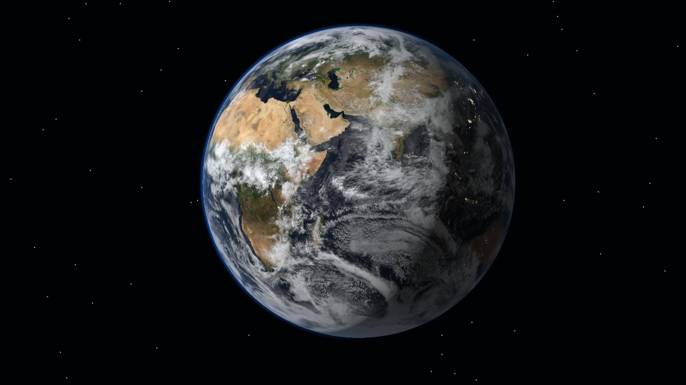
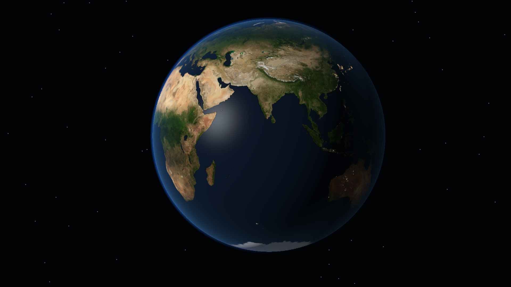
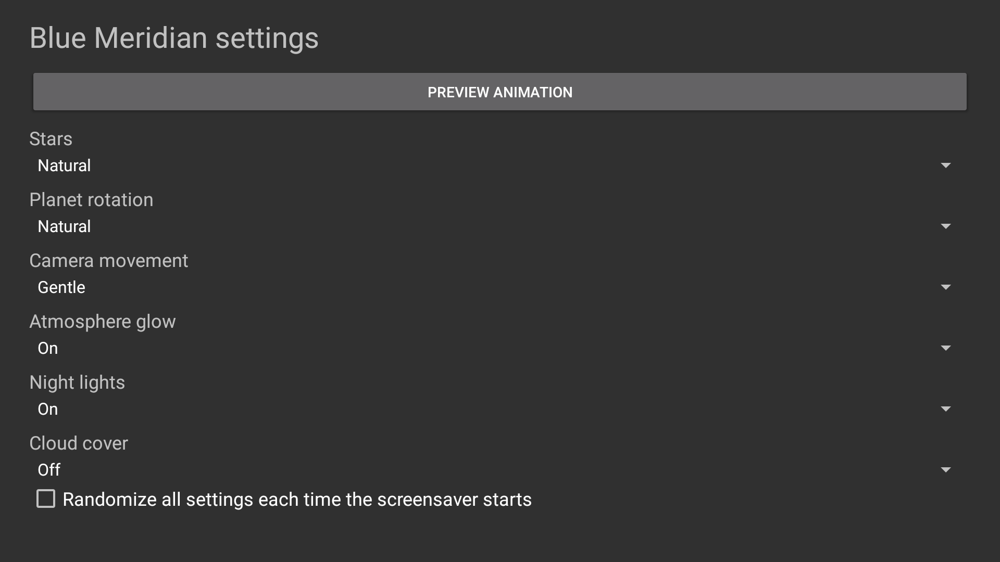

<p align="center">
  <a href="https://github.com/jeremykenedy/blue-meridian#gh-light-mode-only"><picture><source media="(max-width: 600px) and (prefers-reduced-motion: reduce)" srcset="art/banner-mobile-still-light.93882baf5cc8.svg"><source media="(prefers-reduced-motion: reduce)" srcset="art/banner-still-light.a68a323eced0.svg"><source media="(max-width: 600px)" srcset="art/banner-mobile-light.b106ea8182ac.svg"></picture></a>
  <a href="https://github.com/jeremykenedy/blue-meridian#gh-dark-mode-only"><picture><source media="(max-width: 600px) and (prefers-reduced-motion: reduce)" srcset="art/banner-mobile-still-dark.fe074899bfce.svg"><source media="(prefers-reduced-motion: reduce)" srcset="art/banner-still-dark.52ce550c7331.svg"><source media="(max-width: 600px)" srcset="art/banner-mobile-dark.85ce32b35dcb.svg"></picture></a>
</p>

<p align="center">A continuously animated view of Earth from space for Fire TV, Android TV and Google TV.</p>

<p align="center">
    <a href="https://github.com/jeremykenedy/blue-meridian/releases"></a>
    <a href="https://github.com/jeremykenedy/blue-meridian/releases"></a>
    <a href="https://github.com/jeremykenedy/blue-meridian/actions/workflows/ci.yml"></a>
    <a href="https://github.com/jeremykenedy/blue-meridian/actions/workflows/style.yml"></a>
    <a href="https://github.com/jeremykenedy/blue-meridian/actions/workflows/docs.yml"></a>
    <a href="https://github.com/jeremykenedy/blue-meridian/actions/workflows/security.yml"></a>
    <a href="LICENSE"></a>
</p>

<p align="center">
    <a href="https://github.com/jeremykenedy"></a>
    <a href="https://github.com/jeremykenedy/blue-meridian" title="Open the repository and click Star"></a>
    <a href="https://github.com/sponsors/jeremykenedy"></a>
</p>

## Contents

- [Privacy](#privacy)
- [Features](#features)
- [Requirements](#requirements)
- [Installation](#installation)
- [Fire TV Toolkit](#fire-tv-toolkit)
- [Configuration](#configuration)
- [Screenshots](#screenshots)
- [Building and testing](#building-and-testing)
- [Documentation](#documentation)
- [License](#license)

## Privacy

Blue Meridian contains no ads, analytics, tracking, telemetry, crash reporting or runtime network access. The Android manifest declares no Internet permission. Preferences stay on the device. The standalone installer contacts GitHub only after you ask it to download a release APK and checksum; it sends no TV, device or usage data.

## Features

- Continuously rotating, shaded Earth rendered with OpenGL ES 2 and detailed NASA satellite imagery.
- Slow, natural and fast rotation speeds.
- Still, gentle and sweeping camera movement.
- Sparse, natural and dense star fields.
- Optional thin atmosphere, independently drifting satellite clouds, and mapped city lights on the night side.
- Independent Random choices and an option to randomize all settings on each screensaver start.
- D-pad friendly settings screen and an app-owned settings provider for host apps.
- Standalone release installer, updater and uninstaller.
- No text or watermark in the screensaver scene.

## Requirements

- Fire TV, Android TV or Google TV with Android 6.0 or newer and OpenGL ES 2.0.
- ADB for the command-line installer.
- Android SDK Platform 36, Build Tools 36.0.0, Java and Python 3 to build from source.

The current automated device check uses an Android TV emulator running Android 12 at 1920x1080. No physical Fire TV or Google TV test is claimed in this release.

## Installation

Download the APK from [the latest release](https://github.com/jeremykenedy/blue-meridian/releases/latest) and install it with ADB, or use the included guided installer. Connect the TV with ADB debugging enabled, then run:

```bash
python3 install.py --serial TV_IP:5555
```

The installer downloads the latest stable release and verifies its SHA-256 checksum before installing or updating. To install a local build, pass `--apk build/blue-meridian.apk`. Select Blue Meridian in the device's screensaver or ambient display settings; the installer does not change device settings.

To remove it interactively:

```bash
python3 install.py --serial TV_IP:5555 --uninstall
```

For script use, `--uninstall --yes --force` explicitly confirms removal. See [installation and recovery](docs/INSTALLATION.md) for manual install, update and uninstall steps.

## Fire TV Toolkit

[Fire TV Toolkit](https://github.com/jeremykenedy/fire-tv-toolkit) provides guided setup, verified app installation, launcher choices, and supported Fire TV sleep and screensaver controls:

```bash
git clone https://github.com/jeremykenedy/fire-tv-toolkit.git
cd fire-tv-toolkit
node setup.js
firetv-screensavers --install=blue-meridian
firetv-set-screensaver --set=blue-meridian
```

Run `firetv-screensavers --install=blue-meridian` again to update to the latest signed release with checksum verification. Remove the app with `firetv-screensavers --uninstall=blue-meridian --force`. The guided commands explain changes and request confirmation.

The Toolkit also manages available launcher choices, screensaver delays, and supported timer protections. Its Fire TV UI discovers installed Blue Meridian and opens its own settings screen. See the [Toolkit command reference](https://github.com/jeremykenedy/fire-tv-toolkit/blob/main/docs/COMMANDS.md) for device-specific behavior. These controls do not establish physical-device testing for Blue Meridian.

## Configuration

Open Blue Meridian from the TV launcher and use the remote to choose settings. Changes are applied when the screensaver starts again.

| Setting | Choices | Default |
| --- | --- | --- |
| Star density | Sparse, Natural, Dense, Random | Natural |
| Planet rotation | Slow, Natural, Fast, Random | Natural |
| Camera movement | Still, Gentle, Sweeping, Random | Gentle |
| Atmosphere glow | On, Off, Random | On |
| Night lights | On, Off, Random | On |
| Cloud cover | On, Off, Random | On |
| Randomize all settings at each start | On, Off | Off |

Host apps can read the provider schema and current values from `content://com.jeremykenedy.bluemeridian.settings/schema` and `content://com.jeremykenedy.bluemeridian.settings/settings`. See [configuration](docs/CONFIGURATION.md) for the schema, keys and update contract.

## Screenshots

Captures below come from the running Android TV emulator at 1920x1080. They show the animated app preview and the remote-operated settings screen.

<table>
  <tr>
    <td><br>Satellite Earth</td>
    <td><br>Clouds disabled</td>
    <td><br>Settings</td>
  </tr>
</table>

## Building and testing

```bash
bash build.sh
bash test.sh
bash scripts/test-python-coverage.sh
bash scripts/test-coverage.sh
bash scripts/check-style.sh
python3 scripts/check-docs.py
python3 scripts/check-privacy.py
```

The coverage gates require 100 percent line and branch coverage for the settings resolver, validation rules and installer logic. Renderer behavior is verified with the emulator and recorded separately. CI builds an unsigned review APK; the signed release artifact is built and checked locally.

## Documentation

- [Architecture and rendering](docs/ARCHITECTURE.md)
- [Satellite imagery sources and notices](docs/MEDIA.md)
- [Building from source](docs/BUILDING.md)
- [CI checks](docs/CI.md)
- [Configuration and provider schema](docs/CONFIGURATION.md)
- [Installation, update and removal](docs/INSTALLATION.md)
- [Release process](docs/RELEASING.md)
- [Test strategy](docs/TESTING.md)
- [Troubleshooting](docs/TROUBLESHOOTING.md)
- [Device verification](docs/VERIFICATION.md)
- [Version 1.0.1 notes](docs/releases/v1.0.1.md)
- [Version 1.0.0 notes](docs/releases/v1.0.0.md)
- [Security reporting](SECURITY.md)

Show some love by starring this repository on GitHub: [Star Blue Meridian](https://github.com/jeremykenedy/blue-meridian/stargazers).

## License

Blue Meridian is available under the [Apache License, Version 2.0](LICENSE). See [NOTICE](NOTICE) for project notices.
