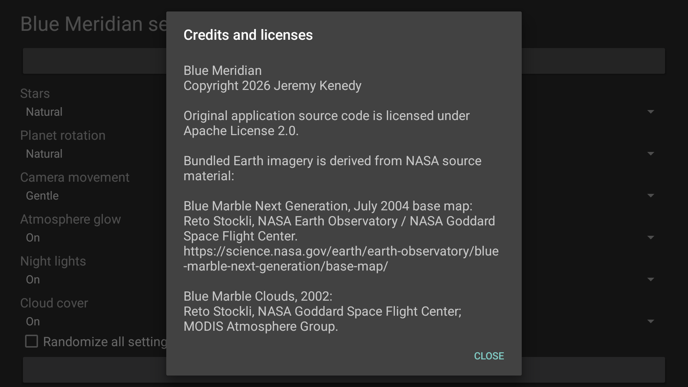
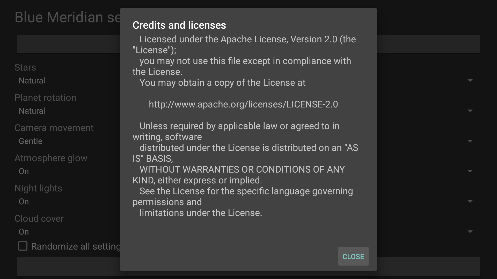
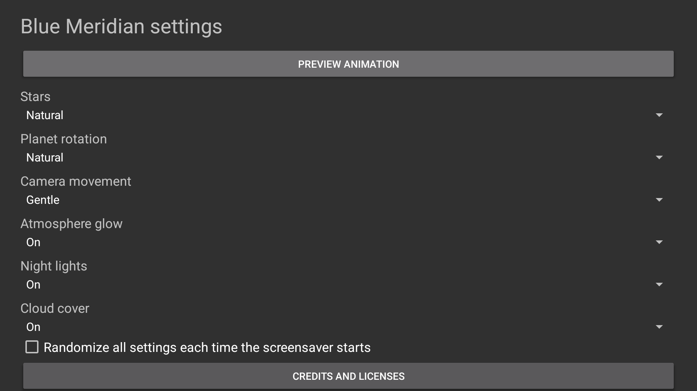

# Device verification

## October 25 physical Fire TV verification

Version 1.0.1/code2 was checked on a physical Fire TV AFTDEC012E running API 30 with a 1920x1080 application surface. No 4K buffer was forced. The frozen renderer candidate SHA-256 is `f554c6f0f927df2b081caf55cc7e989b2a042f37f5709f19f8774f692f67fff1`. It preserves the original package and signing certificate and retained all seven effective saved values during the in-place upgrade.

Normal and fast-rotation captures at 8, 24 and 40 seconds show visible daylight and recognizable geography. A thin vertical filtering seam found in the preceding physical candidate was corrected using wrapped texture gradients. The new captures show no boundary line, incidental words or watermark. The app uses archival photographic maps, not current weather or a filmed orbital view.

Without screen recording, the actual SurfaceView supplied 126 presentation timestamps per sample. Normal Preview measured 30.120 presentations per second, median 33.337 ms and 95th percentile 33.410 ms. Fast rotation measured 30.242, median 33.335 ms and 95th percentile 33.389 ms. The normal Dream measured 30.120, median 33.333 ms and 95th percentile 33.381 ms. Empty Background-for-SurfaceView timestamp lists were excluded rather than interpreted as app frame rates. These short samples are not an extended power or thermal test.

The selected non-test Dream bound after 299.911 seconds following actual D-pad navigation, with the five-minute timeout unchanged. Its visible output was captured after another 40 seconds. Preview/Back, Home, relaunch and Dream exit passed. Cleanup verified the seven app values, all tracked system settings, UI preferences, canonical external file bytes and existence, app-op policy and running UI protection service. No TV power cycle, sleep command, TV restart or ADB restart was performed.

The current native screenshots and their hashes are recorded in [capture provenance](../art/screenshots/fire-tv-api30.json). The embedded preview is a plain 384x216 resize of that capture. The final signed APK is 2,569,417 bytes, SHA-256 `7f3b575f45d7afa5ca68ff8510d84f5b42c6ac6c3c21903628898f6a5dff5ec2`. Every compiled class is byte-identical to the renderer candidate above; only the embedded preview and signature metadata differ. Its installed hash was verified on the same physical TV. A 20-second native Preview recording, actual D-pad focus and opening of Credits and licenses, Back and Home passed. All tracked app, UI and OS configuration, external bytes/existence and app-op policy were retained, and the UI guard remained running. Historical emulator observations below remain useful for the named checks only; their poor host pacing is not physical-TV pacing.

Physical Android TV, Google TV, native 4K composition, extended thermal behavior and reboot persistence remain untested. Volunteers with those devices should report model, OS/API, resolution and native selection, idle activation, animation and remote-exit results.

## Historical candidate checks

## Version 1.0.1 candidate

Verified October 15, 2026 on the Android TV API 31 emulator `fire-tv-ui-final-verification`, model `sdk_google_atv64_arm64`, with 1920x1080 output and host GPU rendering. This documents the candidate before publication. Physical-device verification remains pending.

The signed APK preserves the package and signing certificate of the published 1.0.0 release. It declares version 1.0.1, version code 2, Android API 23 minimum and OpenGL ES 2.0. The manifest exposes the expected DreamService and settings provider and requests no Internet permission. The APK bundles all three NASA textures, source provenance, NOTICE and license.

## Offline credits follow-up

The October 22 follow-up adds a remote-readable Credits and licenses button at the end of Settings. Its scrollable offline dialog reads the full bundled NASA NOTICE and Apache license. No new asset, permission, dependency, renderer or setting was introduced. The package remains version 1.0.1/code 2 with its existing signing certificate.

The frozen follow-up APK is 2,565,321 bytes, SHA-256 `8ed100da7f1d152f6c83eb0cb337a57fefeee3915932d1de4e69e3b8f9883395`. All 12 original non-DEX APK entries, including the NASA textures and notices, and all 11 compiled classes outside Settings are byte-identical to a build of the recovered feature source. Host settings and installer tests, coverage, documentation and privacy checks pass. Coverage remains limited to the pure settings logic and installer; the new Android dialog requires native validation.

The exact follow-up APK passed the native credits and navigation checks below. Physical sustained-motion checks remain pending. The earlier captures below describe the recovered renderer, not validation of the new Settings dialog. No physical smoothness or release completion is claimed.

## Rendering regression

The native lighting check reproduced a visibly black globe on the published 1.0.0 APK: after 24 seconds of fast rotation, mean inner-disc luminance fell to 4.45 and no sampled pixels exceeded the daylight threshold. The same check passes with the new renderer at 8, 24 and 40 seconds. Mean luminance was 93.09, 77.85 and 81.80 respectively; the visible-daylight fraction remained above 0.91. These thresholds detect the lost-daylight regression; they do not establish photographic accuracy.

Direct native captures show the Pacific and western hemisphere with clouds, and Africa, Arabia and India with clouds disabled. North remains up, mapped city lights remain visible on the night side, oceans remain dark, and the atmosphere follows a narrow sunlit limb. The images in `art/screenshots/` are unretouched ADB captures. The embedded 384x216 preview derives from `earth-preview.png`. The release capture comes from the final signed APK.

## Settings and lifecycle

D-pad input changed all seven native controls: star density, spin speed, camera motion, atmosphere, night lights, clouds and randomize-all. Saved values survived a force-stop and restart. Invalid values were rejected for every setting. Both settings and lifecycle checks restored all seven original preferences.

Two Home, resume and Back cycles passed on the candidate and were repeated after the final signed APK was installed. No fatal exception, fatal signal, shader compilation error or OpenGL invalid-operation error appeared in the check window. Preview launches used activity reordering to avoid creating duplicate preview instances in the test harness. The emulator's selected Backdrop screensaver and enabled value remained unchanged.

A 15-second native screen recording contained 422 frames, approximately 28.17 frames per second, with median frame spacing 33.12 ms and 95th percentile 66.02 ms. This measures the captured emulator stream under recording load, not physical GPU presentation, power use or thermal performance. A separate five-second SurfaceFlinger sample without screen recording contained 81 presentation timestamps, with median spacing 34.2 ms, 95th percentile 224 ms and maximum 857 ms. This exposes long stalls on the busy host, so smooth playback has not passed the release gate. Guest process PSS was about 21 MB during the sample; host GPU allocations are outside that number.

## Automated checks

Host installer and settings tests pass. Installer coverage is 226 of 226 statements and 80 of 80 branches. Pure Java settings logic coverage is 37 of 37 lines and 44 of 44 branches, enforced with coverage-ratio limits. These coverage figures exclude Android activities, lifecycle and GLSL, which require native verification. Python compilation, documentation and privacy checks pass locally. The inherited Gradle Spotless task also passes, but its parent-directory globs do not establish a full-source Java formatting audit. No broader formatting claim is made. Remote CI results are checked separately before merge.

## Remaining device gates

| Target | Candidate status | Required verification |
| --- | --- | --- |
| Android TV API 31 emulator | Preview, seven controls, persistence, invalid settings and Home/Back resume verified | Automatic idle activation is unavailable through this emulator's system settings. |
| Physical Fire TV | Pending | Actual screensaver selection, moving output, idle activation, remote exit, sleep/wake persistence and sustained playback. |
| Physical Android TV and Google TV | Pending | Discovery, selection, idle activation, remote exit and sustained playback. |
| Native 4K and sustained operation | Pending | Native display composition, frame pacing, thermal behavior and idle power on supported hardware. |

Historical 1.0.0 verification used an API 31 emulator on October 8, 2026. Its earlier screenshots and rendering observations do not validate the replacement renderer.

## October 22 exact credits candidate

Android API 34 emulator checks used the frozen APK hash above with actual 1920x1080 captures. D-pad navigation reached Credits and licenses, scrolled through the full NOTICE and license to its end, and selected the positive Close button. Preview returned to Settings with Back; the actual DreamService bound and exited with Back. All eight saved system keys and the original screensaver selection were unchanged, and the emulator returned Home. No app data was cleared or uninstalled.

This app was not installed on the shared emulator before the test. Its 7 exposed values were captured after installation and restored exactly; this does not prove pre-upgrade data retention. These are native credits/lifecycle checks, not physical smoothness, automatic idle, 4K or thermal verification.

[Sanitized capture provenance](../art/screenshots/credits-api34.json) records the artifact and screenshot hashes.

<table>
  <tr>
    <td></td>
    <td></td>
    <td></td>
  </tr>
</table>
